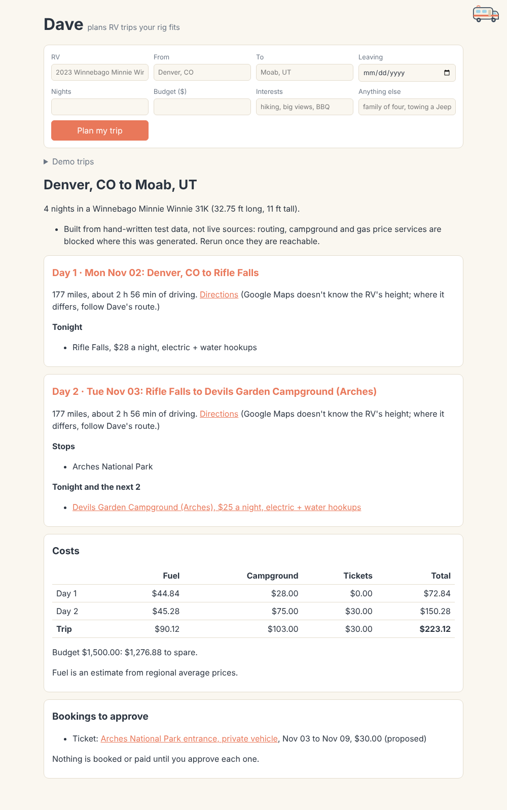

# Dave, an RV trip planner

<p align="center">
  
</p>

<p align="center">
  <b>Dashboard</b>
  <br>
  
  <br>
  <sub>Dave's local dashboard with demo trip 1, built from recorded test data. Screenshot from this project.</sub>
</p>

<p align="center"><i>Dave won't send your rig under a bridge it can't clear. He checks the height in code.</i></p>


Ask an RVer about a bad trip and you hear about a bridge that came up too fast, a campsite
three feet too short, or a seven-hour drive day. Dave is the friend who measured first. He
knows how tall and long your rig is, and he won't call a plan final until code has checked
both against the route and every night's campsite.

Dave is an RV trip planning agent built on the Anthropic Claude API and the Claude Agent SDK.
He reads a plain-language trip request, identifies the RV and reads its size from the maker's
spec page, routes around low bridges, splits the drive into days of 5 hours or less, picks a
campground with electric and water hookups for each night, and adds stops and meals that
match the traveler's interests. He prices fuel, campgrounds and park tickets against the
budget and prepares a booking proposal for each one. Then he stops, because a person approves
and books every campground and ticket.

## Dave by the Numbers

| Outcome | Result |
| --- | --- |
| Real trips planned with Dave | **3**, including museum stops the author would have driven past |
| Planning time saved | **~10 hours** across the 3 trips |
| Saved on campgrounds | **$250** in total, compared with the campgrounds the author would have booked |
| Real-world checks passed on demo trip 1 | **2 of 5** (Dave's drive times run 22% to 24% short of OSRM's) |
| Hard rules checked in code before a plan is shown | **5**: clearance, site length, hookups, 5 h a day, budget |
| Free data sources | **6**: Foursquare, RIDB, OSRM, Overpass, EIA, maker spec pages |
| Automated tests | **347**, run in CI on every pull request and push to `main` |
| Lines of Python | **5,688** in `src/dave/`, plus 4,079 lines of tests |

The trip count, time saved and campground savings are the author's own figures from those
trips. The real-world score comes from [evals/scorecard.md](evals/scorecard.md), which
compares demo trip 1 with facts collected from OSRM, Recreation.gov and Overpass. The test
count comes from `uv run pytest` and the line counts from `wc -l` on this commit.

## How Dave Works

```mermaid
flowchart LR
    R[Trip request: text or dashboard form] --> P[Request parser: text to constraint spec]
    R --> O[Orchestrator: Claude agent loop]
    P --> V[RV lookup: catalog match and spec page]
    O -.->|identify_rv| V
    O -.->|rv_dimensions| V
    V --> RT[Router: OSRM days of 5 h or less]
    RT <--> CL[Clearance check: bridges vs RV height]
    RT --> CG[Campground picker: fit, scenery, price]
    CI[(Campground index: LanceDB)] --> CG
    CG --> SF[Stop and meal finder: interests and detours]
    SF --> FU[Fuel planner: EIA prices and fill-ups]
    FU --> BU[Budget fitter: costs and cheaper swaps]
    BU --> BK[Booking proposals: approval gate]
    BK --> VA[Validator: every hard rule in code]
    VA --> RE[Renderer: Markdown itinerary and dashboard]
    RE -->|you review| H[You approve and book each stay]
```



1. **Understand.** Claude turns the request into a constraint spec with structured outputs.
   Code fills in the defaults from [context/domain.md](context/domain.md) (5 h of driving a
   day, electric and water hookups) and asks a follow-up only for a missing origin,
   destination, number of nights or RV.
2. **Measure.** An offline catalog of 9 manufacturers identifies the RV, and code reads its
   length, height and tank size from the maker's spec table. When a number is missing, Dave
   uses a class estimate that leans long and tall and marks it `estimated`.
3. **Route.** OSRM gives the route, with RV time set to car time × 1.10. Any bridge lower
   than the RV's height plus 6 inches triggers a reroute. The drive is then cut into equal
   days of 5 hours or less, so there is no short stub on the last day.
4. **Fill.** Each night gets a campground within 25 miles of the day's end that has a site
   with the needed hookups and length. Each day gets 1 to 3 stops, a lunch and a dinner,
   and fill-ups planned so the tank never drops below a quarter.
5. **Check.** Costs are added up per day. Over budget, Dave swaps in cheaper campgrounds that
   fit, then drops the priciest paid stop. `validate_itinerary()` then checks every hard rule.
   A plan that fails is labeled "Not final" with the reasons.
6. **Hand over.** Every campground and ticket becomes a proposal with a link, dates and a
   price. Nothing is booked until a person approves that exact proposal.

Today `dave plan` and the dashboard send the request to the orchestrator, whose tools cover
the RV (`identify_rv`, `rv_dimensions`) and the trip defaults (`trip_defaults`). The route,
campground, stop, cost and booking stages are Python functions with their own `dave`
commands. `tests/test_budget.py` and `tests/test_render.py` chain them from routing to the
rendered plan to build [demo trip 1](demo/itinerary-1-denver-moab.md) from recorded data.

## The Technical Bits, Explained

### AI development: one agent, one parser, and plain code for the rest

| Component | Model | What it does | How it is kept honest |
| --- | --- | --- | --- |
| **Request parser** | Claude Opus 5.5; optional fine-tuned Qwen2.5-3B | Extracts what the traveler said into a constraint spec. | Structured outputs into a pydantic model, `null` for anything unstated, unknown fields rejected, scored on 20 eval cases. |
| **Orchestrator** | Claude Opus 5.5 via the Claude Agent SDK | Runs the planning conversation with Dave's own tools. | Built-in tools turned off (`tools=[]`), only `mcp__dave__*` tools allowed, at most 20 turns. |
| **RV lookup** | None; Claude Opus 5.5 only for pages without a spec table | Identifies the RV and reads its size from the maker's page. | Numbers outside a plausible range for the class are dropped; missing ones become cautious estimates. |
| **Router** | None | Gets the OSRM route and splits it into balanced days. | Tests require every day to be at or under the limit, with no stub days. |
| **Clearance check** | None | Finds `maxheight` limits on the route and reroutes around low ones. | A road counts only when 2 or more of its nodes lie on the route; a low bridge with no way around stays as a warning. |
| **Campground index** | BAAI/bge-small-en-v1.5 via fastembed | Searches campgrounds by meaning with hard filters. | Filters keep only campgrounds known to match hookups, length and distance. |
| **Campground picker** | None; the scenery score uses bge-small embeddings | Picks one campground per night. | A site must fit on hookups, length and amps; "call to confirm" never beats a known fit. |
| **Stop and meal finder** | None | Picks stops by interest and lunch and dinner along the way. | Detour driving counts against the 5 h limit; coffee shops and bars are not meals. |
| **Fuel planner** | None | Estimates fuel cost from EIA prices and plans fill-ups. | Output names the EIA area and price week and says "about"; RVs over 25 ft only use truck stops. |
| **Budget fitter** | None | Adds up costs and brings an over-budget plan under budget. | Each change is listed with what it saves and what it gives up; fuel is never cut. |
| **Booking proposals** | None | Turns stays and tickets into proposals with links. | A SHA-256 digest locks the approved terms; `book()` refuses anything else. |
| **Validator** | None | Checks every hard rule before a plan is shown. | Unknown facts fail: an unmapped bridge or an unlisted site length stops the plan. |
| **Renderer** | None | Writes the Markdown itinerary the dashboard shows as day cards. | Runs the validator itself and prints a "Not final" banner on any failure. |

Every external call goes through one cached HTTP client (`src/dave/http.py`) with retries and
per-host rate limits. The parser and the spec-page reader cache each Claude reply on disk by a
hash of the model, the instructions and the prompt, so reruns cost nothing.

- **Hard rules in code, judgment in the model.** Claude reads free text, where judgment
  helps. Bridge height, site length, hookups, drive hours and budget are decided by plain
  Python in `site_fit.py`, `clearance.py`, `days.py`, `budget.py` and `validator.py`. The
  model never decides whether a rig fits.
- **Grounded extraction, defaults in code.** The parser asks Claude only for what the
  traveler stated, with `null` for the rest (`src/dave/parser.py`). Code then applies the
  domain defaults, so a model can't invent a budget or a start date.
- **A least-privilege agent.** The orchestrator runs with every built-in Claude Code tool
  turned off, so it can't read files or run shell commands. Its tools are served from an
  in-process MCP server (`src/dave/tools/`), and none of them can approve, book or pay.
- **Fallback to a cheaper model, safely.** When `DAVE_PARSER_URL` points at a fine-tuned
  model server, Dave asks it first. If the server is down or the reply isn't valid JSON for
  the schema, Dave falls back to Claude (`src/dave/small_parser.py`).

### Architecture design: deterministic where possible, agentic where it pays

- **Human in the loop by design.** `approve()` records who approved, when, and a SHA-256
  digest of the kind, name, dates, price, cancellation policy and link. `book()` refuses
  before calling any payment code unless the status is approved and the digest still
  matches. No booker exists in the repo, and the dashboard has no booking buttons.
- **Unknown means no.** The validator treats missing facts as failures. A campground with no
  listed site length, or a day with an unchecked bridge, makes the plan "Not final".
- **Per-site fit, not per-campground.** A campground can have 50 A sites and 40 ft sites with
  no single 40 ft site that has 50 A. So `Campground.sites` keeps every RV site, and
  `site_fit.check_campground()` passes only when one site has everything.
- **Cached, rate-limited HTTP.** `CachedClient` keys each response by a SHA-256 of method,
  URL, params and body. API keys a source wants in the query string go in `secret_params`,
  which stay out of the cache key. Errors are never cached.
- **Swappable vector store.** Callers use `CampgroundIndex` with two methods, `build` and
  `search`. LanceDB is an implementation detail, so pgvector could replace it.
- **A local dashboard with no server to host.** `dave dashboard` runs on Python's built-in
  `http.server` bound to 127.0.0.1. It works the same on Windows and Mac, escapes planner
  output so it can't inject HTML, and opens saved demo itineraries without calling Claude.

### Machine learning and evaluation: measuring the model instead of trusting it

- **Synthetic data with exact labels.** `src/dave/dataset.py` composes 2,000 training and 100
  test requests from clauses and the personas in [customers/personas.md](customers/personas.md).
  Each label is built alongside its text, so it is right by construction. The test set uses
  places the training set never mentions, to measure generalization.
- **Parameter-efficient fine-tuning (QLoRA).** [training/qlora_parser.ipynb](training/qlora_parser.ipynb)
  tunes Qwen2.5-3B-Instruct with a 4-bit NF4 base and LoRA rank 16 on all attention and MLP
  layers, sized for a free Colab T4. It learns only the JSON answer (completion-only loss).
  It passes when it reaches 95% of Claude's field accuracy on the same test set.
- **Contrastive embedding tuning.** [training/finetune_embeddings.ipynb](training/finetune_embeddings.ipynb)
  tunes bge-small with in-batch negatives plus one hard negative. It is scored by recall@5
  and MRR on a stable held-out 20% of campgrounds, using phrasings the training never saw.
- **Explainable ranking.** Scenic score is 0.5 meaning (closeness to five scenic
  descriptions), 0.3 scenic word mentions and 0.2 rating. Each score carries plain-language
  reasons, and `dave eval-scenic` measures top-third precision against hand labels.
- **Real-world evaluation harness.** `src/dave/evaluate.py` compares a plan with reference
  facts kept as data in [evals/reality/](evals/reality/README.md), each with its source and
  check date. Drive time must be within 15%, nightly price within $5 and gas within 5%.
  Checks with no reference data are listed as "Not evaluated" instead of being dropped.
- **Offline evaluation.** 347 pytest tests run in GitHub Actions on every pull request and
  push to `main`, with no network. HTTP is answered from recorded fixtures or
  `httpx.MockTransport`, and the cached client fails loudly on any missing fixture. Claude is
  replaced by a fake client with scripted replies, and the embedding model by a small
  concept embedder in `tests/conftest.py`.
  - **Validator** (`test_validator.py`): a low clearance, a day over the limit, a missing
    hookup, a short site, an unknown site length, an over-budget plan or a booking changed
    after approval is always reported, and every broken rule is listed.
  - **Approval gate** (`test_booking.py`, `test_campground_booking.py`, `test_tickets.py`): an
    unapproved proposal is never booked, changing any term voids the approval, setting the
    status by hand can't fake one, and the agent has no tool to approve, book or pay.
  - **Clearance check** (`test_clearance.py`): a 12 ft RV is rerouted around Durham's 11foot8
    bridge, a 9 ft van keeps the direct route, a crossing road's limit is ignored, and a low
    bridge with no way around stays as a warning.
  - **Router** (`test_routing.py`, `test_days.py`): RV time is 10% slower than car time,
    every day is at most 5 hours with no stubs, and repeat routes come from the cache.
  - **Site fit and campground picker** (`test_site_fit.py`, `test_overnight.py`,
    `test_vectors.py`): one fitting site is enough, a towed car counts toward length, unknown
    length is "call to confirm", and a known fit always beats a prettier unknown.
  - **Stop and meal finder** (`test_pitstops.py`, `test_restaurants.py`, `test_interests.py`,
    `test_largest_x.py`): detours always fit under the daily limit, a stop is used on one day
    only, and hikers and museum fans get different stops.
  - **Fuel planner** (`test_fuel_cost.py`, `test_gas_prices.py`, `test_fillups.py`): a state
    without its own EIA series falls back to its region, then the U.S., the tank never
    drops below a quarter, and the EIA key never enters the cache.
  - **Budget fitter** (`test_budget.py`): cheaper campground swaps come before dropped stops,
    and a plan still over budget says by how much.
  - **Request parser** (`test_parser.py`, `test_small_parser.py`, `test_finetune.py`):
    missing essentials produce a question, an invalid fine-tuned reply falls back to Claude,
    and a reply that isn't valid JSON scores zero.
  - **Renderer and dashboard** (`test_render.py`, `test_dashboard.py`): demo trip 1 must match
    the saved itinerary, a failing plan is marked "Not final", and planner output can't
    inject HTML.

### The creative bits (what sets Dave apart)

- **A bridge you only drive over doesn't count.** OpenStreetMap tags a height limit on the
  road that passes under a bridge. Dave counts a limit only when 2 or more of that road's
  nodes lie within about 25 m of the route, so a road that merely crosses the route is
  ignored. When something is too low, he tries OSRM's alternatives, then detours through a
  waypoint a mile north, east, south or west of the bridge.
- **Days without stubs.** A 5.9 hour drive becomes two days of about 3 hours, not 5 hours
  plus a 54 minute stub. Dave finds the fewest days that keep each one under the limit, then
  cuts the route geometry into equal parts.
- **Cheapest-ahead fill-ups.** At each stop Dave buys just enough fuel to reach a cheaper
  station within range, else fills the tank, and never plans below a quarter tank. Savings
  come from buying in the cheaper state before crossing into a dearer one.
- **Proof for the quirky stops.** Every "World's Largest" seed in `src/dave/largest_x.json`
  carries its claim and the page it was checked against. Name searches keep only places
  whose names actually say largest, biggest or tallest.
- **An approval that remembers what you saw.** The approval stores a digest of the exact
  terms. If the price or dates change after you say yes, the approval is void and Dave asks
  again.
- **Google Maps links with a warning.** Each day gets a directions link through its stops
  to that night's campground. Google doesn't route for RV height, so each link says to
  follow Dave's route where they differ.

## Debugging Stories

**The six features that were merged but missing.** Six reviewed pull requests showed as
merged on GitHub, yet `main` had no campground picks, restaurants, gas stations, budget,
booking handoff or renderer. It was hard to spot because every PR page said "Merged".

I solved it in 4 rounds, one cause at a time ([PR #36](https://github.com/armita-jamshidi/RV-trip-agent/pull/36)).

1. **Find where the code went.** The PRs were stacked, and their base branches weren't
   deleted after their own merges, so GitHub never retargeted them to `main`. T17 had merged
   into the T14 branch, T23 into the T21 branch, and T20, T24, T26 and T33 into the T17
   branch. One PR carried all six into `main`.
2. **Restore the lost decisions.** Almost every merge conflicted in `context/decisions.md`,
   because every task branch appended a line to its end. Resolving those conflicts had
   dropped the T14 and T17 decision lines. I restored them and removed one duplicated line.
3. **Merge both sides.** `context/decisions.md` got `merge=union` in `.gitattributes`, so
   branches still editing it keep both sides instead of conflicting.
4. **Remove the shared file.** New decisions now go in `context/decisions/`, one dated file
   each. The rule is in `CLAUDE.md` and `REVIEW.md`, so every new branch follows it.

The lesson: check what actually landed on `main`, not what the PR page says, and when
parallel work keeps colliding in one file, change the structure so it can't collide.

**More bugs caught along the way:**

- **Gas checks vanished from the scorecard.** EIA couldn't be reached, so the evaluator had
  no reference gas prices and silently skipped those checks. Checks without data now appear
  under "Not evaluated" in `evals/scorecard.md`.
- **Overpass refused the requests.** Overpass answers 406 to httpx's default User-Agent and
  502 or 504 to large queries when busy. Reference clearances were collected with a
  descriptive User-Agent, small bounding boxes and retries.
- **OSRM routes were blocked by the proxy.** The network proxy refused OSRM URLs with `;`
  between coordinates. Querying with OSRM's `polyline(...)` coordinate form got through.
- **Day cards lost their lists.** The renderer puts a list right under a bold line such as
  `**Tonight**`, and Python-Markdown only starts a list after a blank line. The dashboard
  now inserts that blank line before converting (`src/dave/dashboard.py`).

## What I Learned

- **The Claude Agent SDK:** in-process MCP tool servers with `@tool` and
  `create_sdk_mcp_server`, turning off built-in tools with `tools=[]`, allow-listing tool
  names, and capping turns.
- **The Anthropic Claude API:** structured outputs with `messages.parse` into pydantic models,
  caching replies by a hash of model and prompt, and using Claude only as a fallback where
  plain code can do the job.
- **Geospatial data:** OSRM routing, Overpass queries for `maxheight`, parsing height formats
  (`3.7 m`, `12'4"`), corridor search with estimated detours, and haversine distances.
- **Retrieval:** local CPU embeddings with fastembed, LanceDB search with hard filters, and
  rescaling similarities so a ranking can explain itself.
- **Fine-tuning and evaluation:** generating labeled data by construction, QLoRA on a free
  Colab GPU, contrastive embedding tuning, recall@5 and MRR, and field-level accuracy with
  loose text matching.
- **Testing and CI:** pytest with recorded fixtures and `httpx.MockTransport`, golden files
  refreshed by an environment flag, and GitHub Actions running `ruff check`,
  `ruff format --check` and `pytest`.
- **Safety by design:** approval gates bound to a digest of the terms, least-privilege tools,
  and validators that fail on unknown facts.
- **Building with an AI coding agent:** Claude Code works a Notion board one task per hourly
  run, with one branch and one PR per task, rules in `CLAUDE.md`, a `REVIEW.md` checklist,
  and a decision log of one file per decision.

## Tech Stack

| Area | Technology |
| --- | --- |
| Language | Python 3.12, pydantic 2 (typed models in `src/dave/models.py`) |
| LLM | Claude Opus 5.5 (`claude-opus-5-5`): the orchestrator through the Claude Agent SDK with an in-process MCP tool server, and the request parser and spec-page reader through the `anthropic` SDK with structured outputs |
| Fine-tuning | Qwen2.5-3B-Instruct with QLoRA (transformers, TRL, PEFT, bitsandbytes) and bge-small embedding tuning, on Google Colab |
| Data | LanceDB (campground vectors), fastembed with BAAI/bge-small-en-v1.5 (CPU embeddings), JSON Lines and JSON files for campgrounds, gas snapshots and datasets |
| HTTP and documents | httpx (cached client with retries), Python-Markdown (itinerary to HTML), python-dotenv (keys from `.env`) |
| Web UI | Python's built-in `http.server` (local dashboard) |
| Quality | pytest, ruff (lint and format), GitHub Actions CI |
| External sources or APIs | Foursquare OS Places, Recreation.gov RIDB, OSRM, Overpass (OpenStreetMap), U.S. EIA, manufacturer spec pages |
| Development tools | Claude Code (hourly task routine), GitHub pull requests, Notion task board, uv, PowerShell |

Dependency ranges are in [pyproject.toml](pyproject.toml) and exact versions in `uv.lock`.
The tested versions are anthropic 1.12.1, claude-agent-sdk 0.2.164, fastembed 0.9.0, httpx
0.28.1, lancedb 0.40.0, markdown 3.10.3, pydantic 2.13.5, python-dotenv 1.2.4, pytest 9.1.1
and ruff 0.16.10. The parser notebook pins transformers 4.55.4, trl 0.21.0, peft 0.17.1 and
bitsandbytes 0.47.0.

## Quick Start

```powershell
git clone https://github.com/armita-jamshidi/RV-trip-agent.git; cd RV-trip-agent
uv sync                              # Python 3.12 and every dependency from uv.lock
copy .env.example .env               # add ANTHROPIC_API_KEY, plus RIDB, Foursquare and EIA keys
uv run dave dashboard                # opens http://localhost:8765/
```

`dave dashboard` opens a local page with a trip form and the four
[demo trips](demo/README.md). It sends one plain-language request to the same planner as
`dave plan` and shows the result as day cards, a cost table, any "Not final" warnings and the
bookings to approve. Saved itineraries in `demo/` open without planning. Use `--port` to pick
another port and `--no-browser` to skip opening a tab.

`dave gas-snapshot` saves EIA's weekly gas and diesel averages to `data/gas_prices/`, one
file per week, so Dave keeps his own price history. Fuel costs use the 60 days before the
trip. See the [T22 decision](context/decisions.md) for why only averages are stored.

`dave campgrounds` writes campgrounds from RIDB and Foursquare to `data/campgrounds.jsonl`,
and `dave index-campgrounds` embeds them into `data/campgrounds.lance` for
`dave find-campgrounds`. The embedding model downloads once into the cache.

API keys live in `.env`, which git ignores; [.env.example](.env.example) lists every
variable. HTTP responses and Claude replies are cached under `.cache/dave/` (change it with
`DAVE_CACHE_DIR`; set `DAVE_OFFLINE=1` to forbid network calls). Data you collect goes in
`data/`, which is also git-ignored. `DAVE_PARSER_URL` and `DAVE_EMBED_MODEL` switch on the
fine-tuned models; both are off by default.

| Command | What it does |
| --- | --- |
| `dave plan "<request>"` | Sends a trip request to the orchestrator and prints its reply. |
| `dave dashboard` | Local web page for planning and browsing trips. `--port`, `--no-browser`. |
| `dave parse "<request>"` | Prints the constraint spec, or the follow-up question. |
| `dave eval-parser` | Scores the parser on `evals/parser/cases.jsonl`; exits 1 below 90% accuracy. |
| `dave compare-parsers` | Parses the demo trips with Claude and the fine-tuned model and lists disagreements. |
| `dave rv "<description>"` | Identifies an RV and prints its size from the maker's spec page. |
| `dave route LAT,LON ...` | Route miles and car and RV hours. `--rv-height` checks bridges and reroutes. |
| `dave campgrounds [LAT,LON ...]` | Ingests campgrounds. `--demo` for the demo regions, `--radius`, `--out`. |
| `dave index-campgrounds` | Embeds ingested campgrounds into LanceDB. `--from` for the input file. |
| `dave find-campgrounds "<query>"` | Searches by meaning. `--hookups`, `--length`, `--near`, `--radius`. |
| `dave eval-embeddings` | recall@5 and MRR of campground search on held-out queries. `--campgrounds`. |
| `dave eval-scenic` | Scores the scenic ranking against hand labels. `--campgrounds`. |
| `dave pitstops LAT,LON ...` | Stops per day along a route. `--interests nature=0.9,...`, `--rv-length`. |
| `dave fuel "<rv>" LAT,LON ...` | Fuel cost per day for an RV on a route. `--on YYYY-MM-DD`. |
| `dave gas-snapshot` | Saves this week's EIA gas and diesel averages. |
| `dave gas-price <state>` | Average price for a state from the snapshots. `--diesel`, `--on`. |

Run `uv run pytest` and `uv run ruff check` to test and lint. The tests make no network or
API calls.

## Safety Rules

- **Dave never spends money without approval.** He prepares proposals; `book()` runs only for
  a proposal a named person approved with unchanged terms, and no payment code exists yet.
- **A plan that breaks a hard rule is never shown as final.** The renderer runs
  `validate_itinerary()` and marks any failure "Not final" with what to fix.
- **Unknown is not safe.** An unmapped bridge or an unlisted site length fails the plan, and
  an estimated RV size leans long and tall and is marked `estimated`.
- **The agent can't touch your computer.** Built-in Claude Code tools are off, and Dave's own
  tools can't approve, book or pay.
- **No secrets in git.** Keys come from environment variables or `.env`, and API keys sent in
  query strings stay out of the cache.

## Repository Map

```text
src/dave/
  cli.py, agent.py          commands and the Claude orchestrator loop
  tools/                    the agent's MCP tools (RV, trip defaults)
  parser.py                 request to constraint spec with Claude
  small_parser.py           fine-tuned parser with Claude fallback
  rv_catalog.py             identify the RV from loose text
  rv_specs.py               read the RV's size from spec pages
  routing.py, days.py       OSRM routes and days of 5 h or less
  clearance.py              low bridges, tunnels and rerouting
  corridor.py               find places along the route
  campgrounds.py            campground ingest from RIDB and Foursquare
  site_fit.py               per-site hookup, length and amp fit
  store/vectors.py          LanceDB campground search with filters
  scenic.py                 scenic ranking with reasons
  overnight.py              one campground per night
  pitstops.py, interests.py stops matched to the traveler's interests
  largest_x.py              checked "World's Largest" roadside stops
  restaurants.py            lunch and dinner along the way
  gas_prices.py             weekly EIA price snapshots
  fuel_cost.py, fillups.py  fuel cost and the fill-up plan
  budget.py, tickets.py     cost rollup, budget fixes, park tickets
  booking.py                approval gate bound to the exact terms
  campground_booking.py     booking links handed to the traveler
  validator.py, render.py   hard-rule check and Markdown itinerary
  dashboard.py              local web page for planning trips
  evaluate.py               score a plan against real-world facts
  parser_eval.py            parser field accuracy
  dataset.py, finetune.py   parser training data and scoring
  embed_tune.py             embedding training pairs and scoring
  http.py, config.py        cached HTTP client and settings
tests/                      offline test suite and recorded fixtures
training/                   Colab notebooks and the parser dataset
evals/                      parser cases, real-world references, scorecard
demo/                       demo trip requests and rendered trip 1
context/                    product, domain rules, sources, decisions
specs/                      constraint spec and itinerary contracts
customers/                  traveler personas for Dave
routines/                   prompt for the hourly task worker
docs/images/                images used in this README
```

## What's Built

The project skeleton, data models, cached HTTP client, the agent shell and `dave plan`, the
request parser, RV identification, interest scoring, routing, the 5 hour day split, route
corridor search, campground ingest, LanceDB campground search, scenic ranking, pitstops,
"largest X" landmarks, booking proposals and the approval gate, ticket proposals, the
fine-tuning dataset and notebooks, fine-tuned model flags, the itinerary validator, weekly
EIA gas snapshots, RV dimensions from spec pages, bridge and tunnel clearance with rerouting,
the hookup and RV length filter, a campground for each night, restaurants, fuel cost
estimates, cheapest-ahead fill-ups, the trip cost rollup and budget enforcement, the
campground booking handoff, the itinerary renderer, the real-world evaluation harness, and
the trip dashboard.
